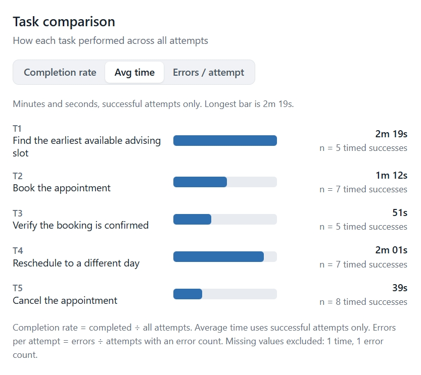
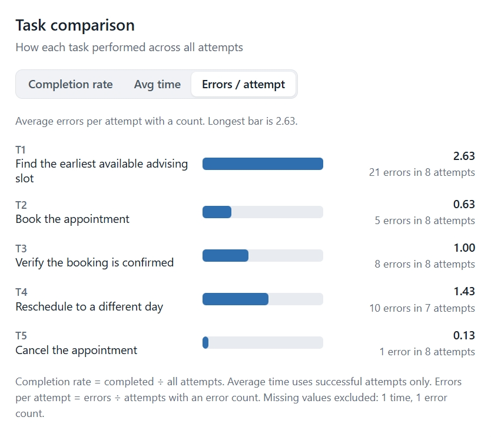
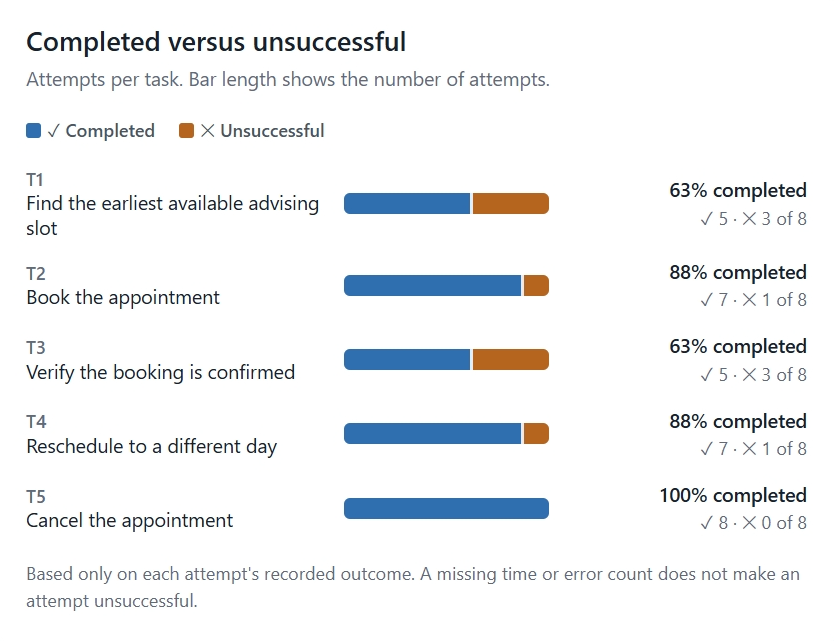
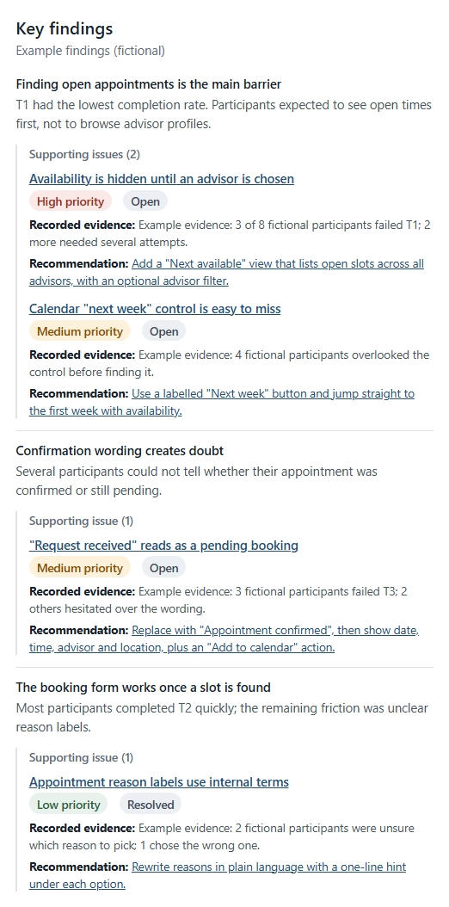
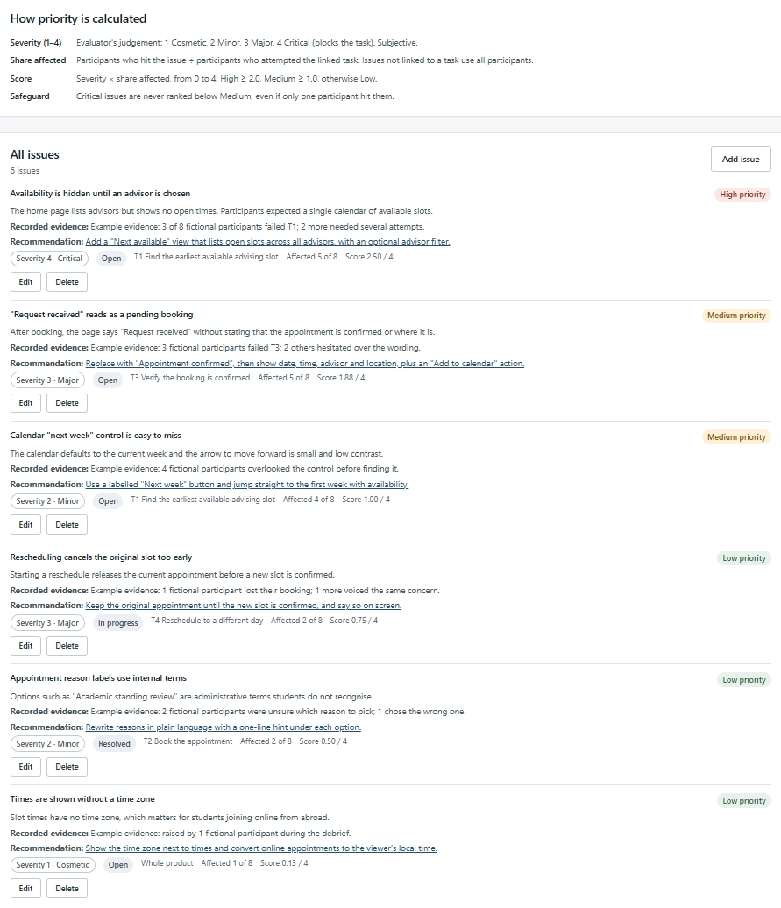
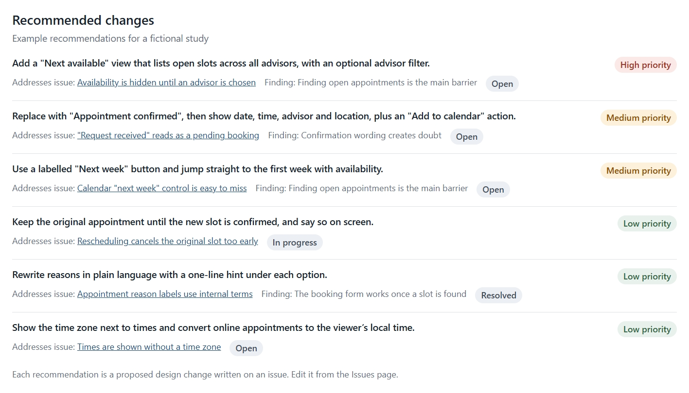

# HCI Usability Testing & Insights Dashboard

A browser-based tool that helps UX and HCI practitioners record a usability study, analyse task performance, prioritise usability issues and turn them into design recommendations.

> **All included data is fictional.** The CampusBook study (a university appointment-booking service), its participants, results and findings were invented for demonstration and do not come from real people or research. Do not enter real or confidential participant data.

## Overview

Usability study results are often scattered across notes, spreadsheets and slides, which makes it hard to trace a recommendation back to the evidence behind it. This dashboard keeps one study in one place: define the tasks, record each participant's attempts, log the issues observed, and see task metrics and issue priorities update from those records. Each recommendation is attached to the issue it addresses, so it can be followed back to the affected task, the participants and the recorded evidence. It is a portfolio project that runs locally in the browser, with no server or account.

## Screenshots

All screenshots show the fictional CampusBook sample study.

### Dashboard

| Task comparison: average time | Task comparison: errors per attempt |
| --- | --- |
|  |  |

| Completed versus unsuccessful attempts | Key findings with supporting issues |
| --- | --- |
|  |  |

### Usability issues

Issues ranked by priority score, with severity, status, affected participants and the calculation explained.



### Recommendations

Proposed design changes ordered by priority, each linked to its issue and, where one exists, its finding.



## Key features

- **Study and task management:** edit study details and add, edit or delete tasks. A task that attempts or issues refer to cannot be deleted.
- **Sessions and task attempts:** record each attempt's outcome, time, error count, observation and participant feedback; filter by participant, task or outcome. Participants are identified by anonymised codes.
- **Usability issues:** log severity, status, the linked task, affected participants, evidence and a recommendation. Issues are ranked by a priority score.
- **Dashboard:** study-wide metrics, a task comparison chart (completion rate, average time or errors per attempt), completed versus unsuccessful attempts per task, and the highest-priority open issues. Everything is calculated from the current records.
- **Findings and recommendations:** findings show the issues that support them, along with each issue's evidence and recommendation. Recommendations are ordered by issue priority and link back to their issue.
- **Export and backup:** CSV exports of task attempts and usability issues, plus a complete JSON backup. A backup is fully validated before import, then either accepted whole after confirmation or rejected with reasons.
- **Local persistence:** changes save automatically in the browser. If saved data cannot be read, it is not overwritten and can be downloaded for inspection.

## Technology stack

- [React 19](https://react.dev/) with strict [TypeScript](https://www.typescriptlang.org/)
- [Vite](https://vite.dev/) for the development server and production build
- [Vitest](https://vitest.dev/) for unit tests of the metrics, prioritisation, editing rules, persistence, export and backup logic
- [ESLint](https://eslint.org/) with typescript-eslint for linting
- Plain CSS with design tokens, and hand-built charts with no charting library
- Browser `localStorage` for persistence, with no backend

## Getting started

Requires npm and Node.js 22 (22.13 or later), 24 or 26+. These are the versions that Vite, Vitest and ESLint all declare support for.

```bash
git clone https://github.com/prxtk7/HCI-Usability-Testing-Insights-Dashboard.git
cd HCI-Usability-Testing-Insights-Dashboard
npm install
npm run dev
```

Open the URL that Vite prints, normally <http://localhost:5173/>. The CampusBook sample study loads automatically.

| Script | Description |
| --- | --- |
| `npm run dev` | Start the development server with live reload |
| `npm run build` | Type-check, then create a production build in `dist/` |
| `npm run preview` | Serve the production build locally (run `build` first) |
| `npm run typecheck` | Run the TypeScript type check only |
| `npm run lint` | Run ESLint |
| `npm test` | Run the unit tests once |
| `npm run test:watch` | Run the unit tests in watch mode |

## Metrics and prioritisation

**Completion rate** = completed attempts ÷ all attempts.

**Average time on task** = mean time of successful attempts that have a recorded time. Unsuccessful attempts are excluded because they often end when a participant gives up, which would distort the average.

**Priority score** = severity (1 Cosmetic to 4 Critical) × share of exposed participants affected, giving a score from 0 to 4.

- Exposed participants are those who attempted the linked task, or all participants if the issue applies to the whole product.
- A score of 2.0 or more is High, 1.0 or more is Medium, and anything lower is Low. Critical issues are never ranked below Medium.
- Severity is the evaluator's judgement, so the score is a triage aid for deciding what to look at first, not a scientific measurement.

Missing values are not treated as zero. A blank time or error count is left out of that calculation, the number left out is shown on the dashboard, and a metric with no usable data appears as unavailable.

## Data and privacy

- Study data is stored in the browser's `localStorage`. It is specific to that browser and device, and clearing browser data deletes it.
- The app has no backend and does not upload study data to a server.
- JSON backups contain the complete study data, including participant profiles, and are unencrypted, as is the data in `localStorage`. Store and share them accordingly.
- CSV exports leave out participant profiles but include free-text observations, feedback and evidence.
- The included CampusBook study is fictional. Do not enter real or confidential participant data.

## Limitations

- **One study per browser:** there are no accounts, synchronisation or collaboration. A study moves between browsers only through a backup file.
- **No blank study:** the app starts from the sample, with no action to start empty.
- **Limited record editing:** participants cannot be edited or deleted, and findings cannot be written or edited in the app. They come only from the sample study or an imported backup.
- **One attempt per task:** a participant cannot have repeated attempts at the same task.
- **Descriptive metrics only:** there are no confidence intervals, significance tests or standardised questionnaires such as SUS.
- **Backup-only import:** only this app's JSON backups can be imported, up to 5 MB. CSV files cannot.
- **Logic-only tests:** automated tests do not cover rendered components or end-to-end flows.
- **Not deployed:** there is no hosted version.
